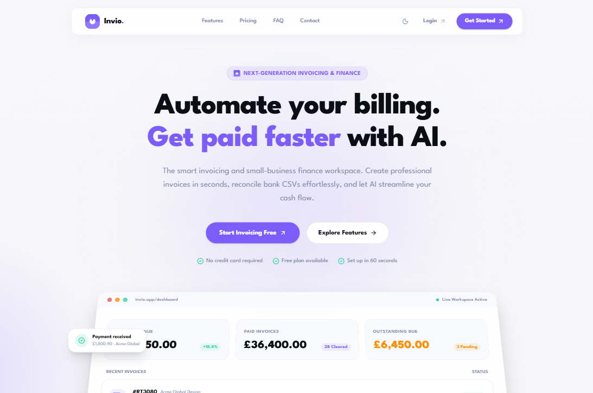
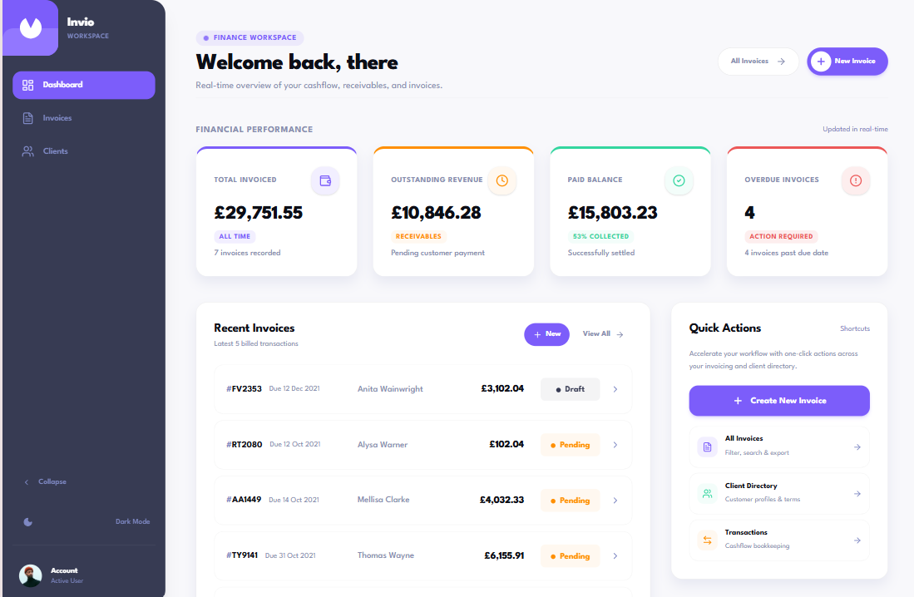

# Invio

**AI-powered invoicing and small-business finance workspace.**

Invio helps freelancers and small studios create professional invoices in seconds, manage clients, and an AI assistant that drafts work for you but never acts without your approval.

> **Status:** active development. Phases 0–3 are done and Phase 4 (AI assistant) is in review. Transactions, categorisation and insights are planned.

---

## Screenshots





---

## Highlights

- **Integer-accurate money.** All amounts are stored and calculated in minor units (pence/cents), never floating point, so totals, tax and discounts never drift.
- **Human-in-the-loop AI.** The assistant drafts invoices and payment reminders; nothing is saved or sent until you click.
- **Secure by design.** AI calls run server-side only, with rate limiting and Zod-validated output. Data is scoped per user in Firestore.
- **Accessible motion.** Scroll-driven animations and parallax backgrounds on the public site, all honouring `prefers-reduced-motion`.

---

## What's built

### Public site

- Landing, Features, Pricing, FAQ, Contact, Privacy and Terms pages.
- Reusable motion primitives (staggered reveals, parallax, scroll tilt, count-ups, accordions) built on [`motion`](https://motion.dev), all respecting `prefers-reduced-motion`.
- Page-length ambient gradient background with grain, and a scroll progress bar.

### Authentication & onboarding

- Email/password and Google sign-in, password reset, route guards.
- Two-step business setup wizard that creates the Firestore profile.
- Onboarding enforcement: unconfigured accounts are redirected until setup is complete.
- Anonymous demo mode backed by IndexedDB with seed data.

### Dashboard

- Overview metric cards and a recent-invoices widget (TanStack Query).
- Collapsible, responsive sidebar with a themed loading screen.
- Light and dark themes.

### Clients

- Client directory with add/edit/delete, search, and summary metrics.
- Client picker in the invoice form that auto-fills name, email and address.

### Invoices

- Create, view, edit and delete, with draft / pending / paid status flow.
- Firestore persistence with integer minor-unit math, tax rates and discounts.
- Search, sort and status filtering.
- Accessible confirm dialogs and PDF export.

### AI assistant

- **Invoice drafting:** describe the work in plain English (or pick a preset) and the assistant prefills the invoice form for review. Prefilled fields are highlighted until you edit them. Route: `POST /api/ai/invoice-draft`.
- **Payment reminders:** generate an email from the invoice detail page in Friendly, Firm or Urgent tone, aware of how many days overdue the invoice is. Copy to clipboard or open in your mail client. Route: `POST /api/ai/reminder`.
- Server-side API key, per-IP rate limiting, and Zod validation of model output.

---

## Tech stack

| Area | Choice |
| --- | --- |
| Framework | Next.js 16 (App Router), React 19, TypeScript |
| Styling | Tailwind CSS v4, shadcn/ui, Radix UI |
| Data | Cloud Firestore, IndexedDB (demo mode) via `idb` |
| Auth | Firebase Authentication |
| Server state | TanStack Query v5 |
| Forms & validation | React Hook Form, Zod 4 |
| AI | OpenRouter (server-side route handlers) |
| PDF | `@react-pdf/renderer` |
| Motion | `motion` |
| Tooling | ESLint, Prettier, lint-staged |

---

## Getting started

### Prerequisites

- Node.js 20+
- [pnpm](https://pnpm.io)
- A Firebase project (Authentication + Firestore)
- An [OpenRouter](https://openrouter.ai) API key for the AI features

### Install

```bash
git clone <repo-url>
cd invio
pnpm install
cp .env.example .env.local
```

### Environment variables

[`.env.example`](.env.example) is a template listing every variable the app needs, with placeholder values. The `cp` command above copies it to `.env.local`; replace the placeholders with your own Firebase and OpenRouter credentials.

Never commit `.env.local`. The AI key is read only in server route handlers and is never sent to the browser.

### Run

```bash
pnpm dev
```

Open <http://localhost:3000>.

### Scripts

| Command | Description |
| --- | --- |
| `pnpm dev` | Start the dev server |
| `pnpm build` / `pnpm start` | Production build and serve |
| `pnpm lint` / `pnpm lint:fix` | Lint (and auto-fix) |
| `pnpm format` / `pnpm format:check` | Prettier |
| `pnpm type-check` | TypeScript, no emit |

---

## Project structure

```text
app/
  (external)/     Public marketing pages
  (auth)/         Login, register, password reset
  (dashboard)/    Authenticated app (dashboard, invoices, clients, onboarding)
  api/ai/         AI route handlers (invoice-draft, reminder)
components/
  external/       Marketing sections and ambient background
  motion/         Reusable animation primitives
  pages/          Page-level compositions
  ui/             shadcn/ui primitives
features/         Domain modules (ai, auth, clients, dashboard, invoices, onboarding)
lib/
  ai/             OpenRouter client and rate limiting
  money/          Integer minor-unit math and formatters
  validations/    Zod schemas
  firebase/       Firebase setup
docs/planning/    Implementation plan, PR breakdown, risks and decisions, task tracker
```

Architecture decisions and the risk register live in [`docs/planning/`](docs/planning).

---

## Conventions

- **Money** is always an integer in minor units. Format only at the UI boundary with the helpers in `lib/money`.
- **AI output** is untrusted: validate with Zod and never persist without an explicit user action.
- **Commits** follow `Type(Scope): Description`, for example `Feat(AI): Implement payment reminder generator`.
- **Next.js 16** differs from earlier versions. Check `node_modules/next/dist/docs/` before relying on older APIs.

---

## Contributing

1. Branch from `main` (`feat/...`, `fix/...`).
2. Keep PRs small and scoped to one change.
3. Run `pnpm lint` and `pnpm type-check` before pushing.
